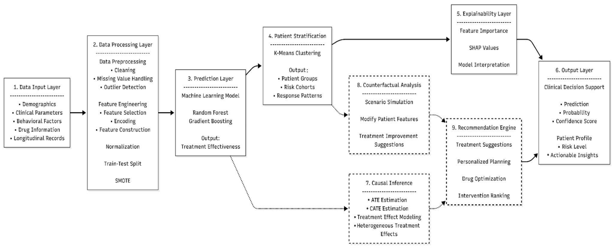
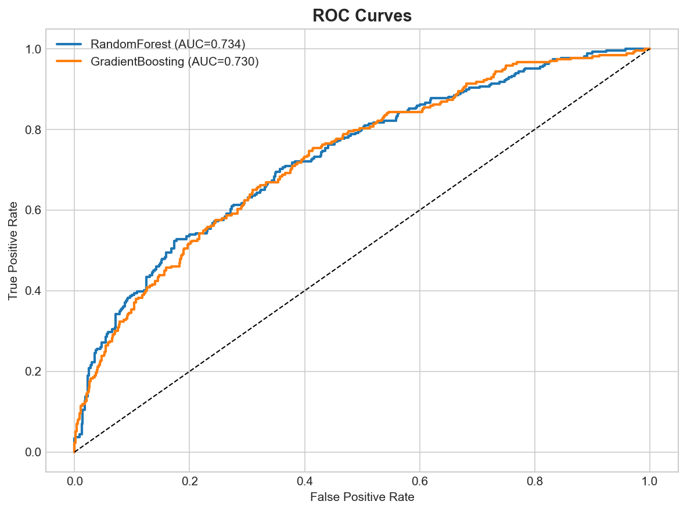

# Cause2Cure

**Causal AI for drug effectiveness across patient groups**

Cause2Cure is an academic research prototype for analysing treatment response in Type 2 diabetes. It combines outcome prediction, patient stratification, model explanations, predictive what-if scenarios and observational causal estimation. This repository curates the existing project source and research evidence for portfolio review.

**Research scope:** All reported experiments use synthetic data. The results do not establish clinical effectiveness, validate prescribing decisions or demonstrate benefit to real patients.

**Research status:** Conference accepted and presented; proceedings publication in progress (status supplied by the project team). The manuscript is withheld while redistribution permission is uncertain; see [paper information](paper/README.md).

## Problem and research objectives

Treatment response can vary between patient profiles, while a predicted outcome alone does not explain the model or identify a causal treatment effect. The project investigates how to:

- Predict the recorded treatment-response outcome from baseline demographic, laboratory, regimen and behavioural features.
- Provide phenotype context and SHAP explanations alongside individual predictions.
- Distinguish changes in model predictions under what-if edits from adjusted population and conditional treatment-effect estimates.
- Present these outputs in a research decision-support workflow, with explicit methodological limitations.

## System architecture

The supplied implementation uses a React dashboard embedded in HTML, a FastAPI service and Python analytics modules. The API reads saved model artifacts and JSON summaries; SHAP explains predictions, while the causal module estimates drug-class add-on contrasts.



This original diagram records the team's conceptual design. Its references to treatment suggestions, optimisation and ranking are not validated clinical capabilities. The supplied recommendation module explicitly avoids prescribing and ranking drugs. See [implementation boundaries](docs/IMPLEMENTATION_NOTES.md) for differences between the manuscript, slides and ZIP.

## Methodology

| Method | Research role | Evidence in this archive |
| --- | --- | --- |
| Random Forest | Baseline-feature classification of treatment response | Existing training and API source; saved evaluation metadata |
| K-Means | Four descriptive patient clusters using six scaled baseline features | Existing clustering source and cluster summaries |
| SHAP | Local feature attribution for the predictive model | Existing TreeExplainer module; attribution is not causal evidence |
| DiCE | Diverse counterfactual explanations described in the manuscript | Manuscript method only; no DiCE implementation or dependency found in the ZIP |
| AIPW | Population average add-on effect, adjusted for measured baseline covariates | Existing five-fold cross-fitted estimator and saved summaries |
| X-Learner | Conditional average treatment effect (CATE) for a patient covariate profile | Existing EconML implementation, one model per drug class |

The ZIP implements rule-based predictive what-if edits. For causal estimation, each treatment is baseline drug-class presence (`drug_v1 > 0`), adjusting for other baseline drug classes and patient covariates. Regimen states 0–3 are **not doses**. Follow-up visit variables are excluded from causal adjustment. The manuscript's broader pipeline is described separately in the [technical report](docs/TECHNICAL_REPORT.md).

## Dataset and evaluation

The supplied CSV contains **4,200 patient records and 32 columns**. Fourteen baseline features are used for prediction. The manuscript reports a stratified **840-record frozen holdout**, with 3,360 development records; the holdout contains 571 majority-class and 269 minority-class observations.

The CSV is retained unchanged. It contains numeric fields and sequential synthetic record IDs, with no names, contact details or free-text notes. The synthetic generation procedure was not supplied. No clinician-entered registry records are included. See the [data dictionary](docs/DATA.md).

The manuscript reports five-fold development cross-validation, training-fold oversampling and a holdout reserved from tuning. The ZIP uses a stratified 80/20 split with seed 42, ordinary SMOTE and fixed model parameters; it selects its saved model by holdout ROC-AUC. These differences limit claims of exact reproduction of the manuscript protocol.

### Verified existing results

“Verified” here means transcribed and cross-checked against supplied documents and saved metadata; these experiments were **not rerun**.

| Model / baseline | Accuracy | Precision (class 1) | Recall (class 1) | F1 (class 1) | ROC-AUC | Source |
| --- | ---: | ---: | ---: | ---: | ---: | --- |
| Random Forest | **69.9%** | 52.9% | 55.0% | 0.539 | **0.7341** | Manuscript, Table III; ZIP metadata; presentation, slide 14 |
| Gradient Boosting | 70.36% | 53.73% | 53.53% | 0.5363 | 0.7302 | ZIP metadata; slide 14 rounds accuracy to 70.4% |
| Always predict majority class | 68.0% | — | — | — | — | Manuscript, Table III |

Random Forest was selected for higher ROC-AUC, although Gradient Boosting has higher recorded accuracy. The paper also reports specificity 76.9%, balanced accuracy 66.0% and MCC 0.316. In the supplied predictive encoding, **class 0 = Effective; class 1 = Not Effective**. Thus the class-1 precision, recall and F1 above concern the minority “Not Effective” label.

The Random Forest confusion matrix is `[[439, 132], [121, 148]]`, with rows representing actual labels and columns predicted labels in order `[Effective, Not Effective]`.



Additional original [confusion matrix](src/models/plots/confusion_matrix.png) and [feature importance](src/models/plots/feature_importance.png) plots are included. No figures were regenerated.

The paper's single worked example changes predicted effectiveness from 22.9% to **71.0%** after lifestyle/adherence edits. **71.0% is a scenario probability, not classification accuracy.** Its reported insulin CATE is +9.7 percentage points and population AIPW estimate is +4.3 percentage points. These are synthetic-data estimates, not clinically validated treatment effects; the paper and ZIP differ on the population confidence interval, as documented in the [report](docs/TECHNICAL_REPORT.md).

## Research limitations

- Synthetic data and an undocumented generation process limit external validity; there is no clinical effectiveness evaluation.
- Predictive discrimination is modest; Random Forest accuracy exceeds the majority baseline by approximately 1.9 percentage points.
- Causal estimates require consistency, positivity and no unmeasured confounding. They are not dose-response estimates or observed individual treatment effects.
- SHAP explains model behaviour. Predictive what-if changes do not establish intervention effects.
- Worked patient outputs are illustrative; held-out causal ground truth and comprehensive subgroup audits are unavailable.
- Differences between the manuscript and supplied code prevent a claim of exact reproducibility. Calibration, DiCE, the registry and other manuscript components are not established by this ZIP.

## Repository contents

```text
Cause2Cure/
├── README.md
├── requirements.txt          # Original Python requirements, unchanged
├── CITATION.cff
├── RIGHTS.md                 # No new software or data licence granted
├── paper/README.md           # Manuscript citation and distribution status
├── docs/                     # Technical report, setup, data and provenance
│   └── figures/              # Original architecture image
└── src/
    ├── api.py                # Existing FastAPI service
    ├── causal.py             # Existing AIPW and X-Learner methods
    ├── explainability.py     # Existing SHAP integration
    ├── recommendations.py    # Existing optional Gemini interpretation layer
    ├── dashboard.html        # Existing frontend; demo credentials removed
    ├── train_models.py       # Existing training source, not executed
    ├── train_causal.py       # Existing causal-training entry point, not executed
    ├── data/                 # Original synthetic CSV
    ├── models/               # Existing JSON metadata and selected plots only
    └── tests/                # Existing test source, not executed
```

## Setup documentation

See [SETUP.md](docs/SETUP.md) for environment preparation and the original artifact paths. The original [requirements.txt](requirements.txt) is preserved; [dependency notes](docs/DEPENDENCIES.md) distinguish declared requirements from manuscript-only libraries.

This is a source and evidence archive. Serialized fitted models and the bundled virtual environment are excluded. The API loads fitted models at import, so a fresh checkout is not a ready-to-run application. No application, training script, test suite, experiment or deployment was executed for this publication task.

## Paper and documentation

- [Manuscript information and publication status](paper/README.md)
- [Short technical report](docs/TECHNICAL_REPORT.md)
- [Implementation differences and archival changes](docs/IMPLEMENTATION_NOTES.md)
- [Dataset dictionary](docs/DATA.md)
- [Figure provenance](docs/FIGURES.md)
- [Publication provenance](docs/PROVENANCE.md)
- [Attribution and rights](RIGHTS.md)

## Team and academic guidance

**Project team:** Aditya Hambire, Kaustubh Jadhav and Shubham Jainapur.  
**Academic guide:** Prof. Devanand Bathe.  
Department of Artificial Intelligence and Data Science, K. J. Somaiya Institute of Technology, Mumbai, India.

No individual contribution allocation is asserted. Please preserve the original team and manuscript attribution. Public availability does not grant a licence; see [RIGHTS.md](RIGHTS.md).
